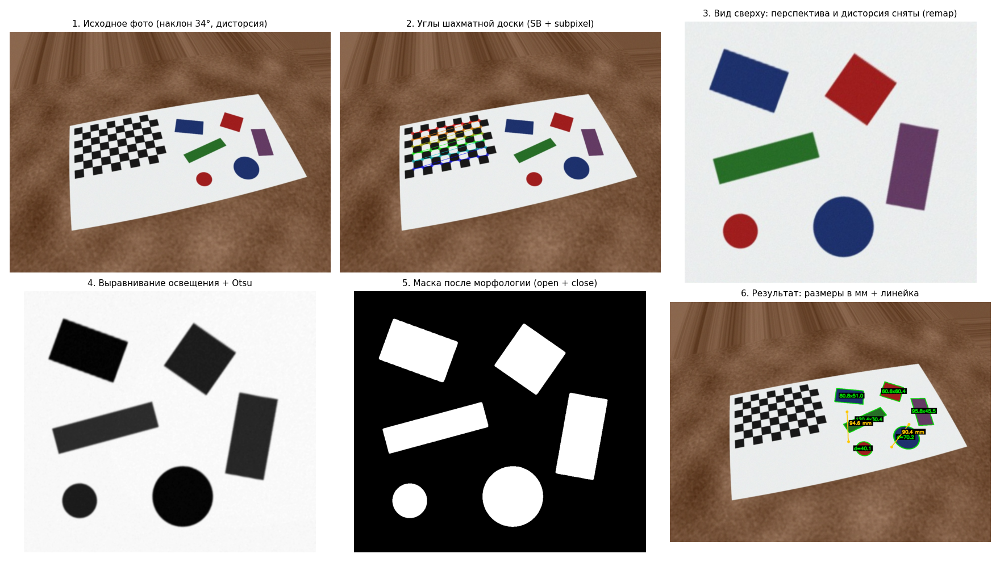
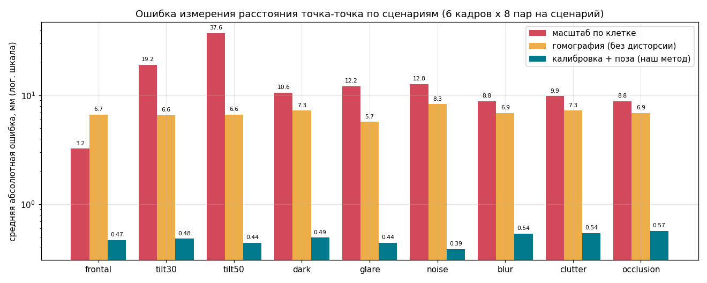

# Виртуальная линейка: измерение расстояний на фото через калибровку камеры

Итоговый проект по дисциплине «Компьютерное зрение 1», вариант 24.
Автор: <ФИО>, группа <ГРУППА>

Программа измеряет расстояния между точками на фотографии в миллиметрах. Для этого камера
калибруется по шахматной доске, а затем доска, лежащая на той же плоскости, что и предметы, задаёт
масштаб. Только классические методы, без нейросетей.



## Как это работает

1. Находим внутренние углы шахматной доски (`findChessboardCornersSB`, субпиксельно).
2. Калибруем камеру по 15–20 снимкам доски (метод Чжана): матрица K и коэффициенты дисторсии.
3. На рабочем кадре находим доску и вычисляем положение плоскости (`solvePnP`, IPPE + LM).
4. Для любого пикселя: снимаем дисторсию, строим луч, пересекаем с плоскостью доски, получаем мм.
5. Расстояние между двумя точками — расстояние между точками пересечения.
6. Автоизмерение предметов: вид сверху (`remap`) -> размытие -> Otsu -> выравнивание освещения -> морфология -> контуры -> `minAreaRect`.

## Запуск

```
pip install -r requirements.txt
python make_chessboard.py                      # печатная доска A4 (печатать в масштабе 100%)
python calibrate.py --images data/calib --cols 9 --rows 6 --square 25
python measure.py фото.jpg                     # кликайте по двум точкам -> мм
python measure.py фото.jpg --auto --roi 235 -20 575 285 --out results/demo.jpg
```

Воспроизвести тесты и рисунки:

```
python make_test_data.py   # синтетические сцены с точной разметкой -> data/
python calibrate.py
python evaluate.py         # метрики -> results/*.csv, results/summary.md
python visualize.py        # рисунки results/fig_*.png
python evaluate_real.py    # проверка на реальных фото (см. докстринг)
```

## Результаты (синтетические тесты, 54 сцены, 432 пары точек)

| Метод | Средняя ошибка | 95-й перцентиль |
|---|---|---|
| Калибровка + поза плоскости (наш) | 0.49 мм (0.35%) | 1.19 мм |
| Гомография по доске, без дисторсии | 6.9 мм (4.1%) | 22 мм |
| Один масштаб мм/пиксель по клетке | 13.7 мм (7.9%) | 46 мм |

Ошибка нашего метода без моделируемого шума клика (0.5 px) — 0.044 мм.
Калибровка: RMS 0.095 px. Скорость: поиск доски ~1.8 с на кадр, одно измерение ~0.08 мс.
Сценарии: фронтально, наклон 30° и 50°, темно, блики, шум, размытие, мусор и тени, перекрытие.



## Ограничения

- Тесты синтетические; реальные фото — в разделе «Реальные данные» отчёта.
- Измеряются только плоские предметы на плоскости с доской (у объёмных верх измеряется неверно).
- Калибровка верна для того же разрешения и фокусировки.
- Блик искажает размеры предметов (~5 мм), перекрытие рукой даёт ошибки опознавания формы.
- Поиск доски медленный (~2 с), доска должна целиком попадать в кадр.

Полный отчёт: [report.md](report.md). Вопросы к защите: [defense.md](defense.md).

## Источники

- Z. Zhang, «A flexible new technique for camera calibration», IEEE TPAMI, 2000.
- T. Collins, A. Bartoli, «Infinitesimal plane-based pose estimation», IJCV, 2014 (IPPE).
- Документация OpenCV: Camera Calibration and 3D Reconstruction.
- N. Otsu, «A threshold selection method from gray-level histograms», 1979.
